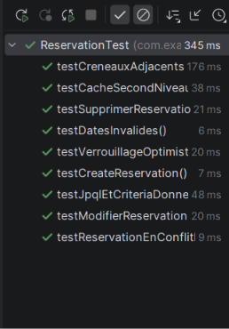

# TP – Réservation de salles avec JPA / Hibernate

## Objectif

Mettre en place la couche de persistance d'une application de réservation de salles avec JPA (Hibernate) et MySQL. Le TP couvre :

- la modélisation des entités et de leurs relations ;
- le cache de second niveau ;
- les migrations SQL ;
- les requêtes JPQL et Criteria API ;
- la gestion des transactions et des conflits ;
- la validation par des tests JUnit 5.

## Résultats des tests

Les 9 tests de `ReservationTest` passent avec succès (345 ms). Ils vérifient la création, la modification et la suppression d'une réservation, le refus des créneaux en conflit et des dates invalides, le verrouillage optimiste, le fonctionnement du cache de second niveau et l'équivalence des requêtes JPQL et Criteria.